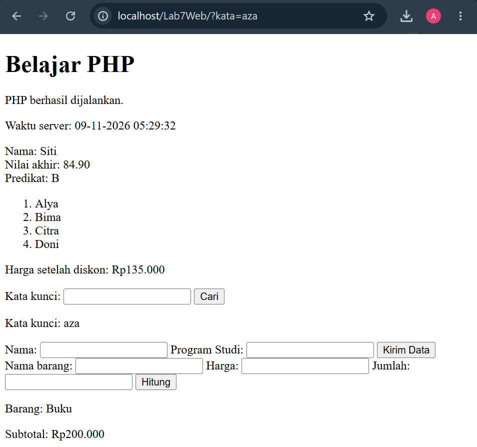
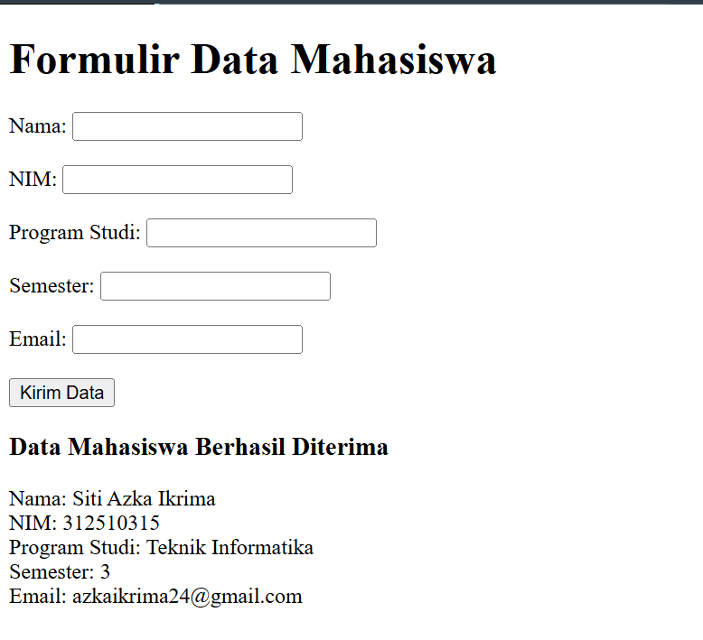
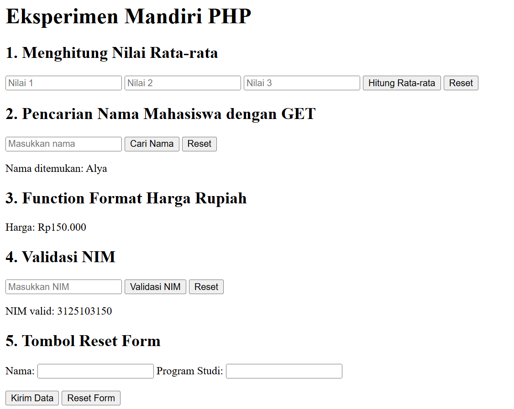

# LAPORAN PRAKTIKUM 7
## Pemrograman Server-Side PHP

### A. Identitas Praktikum

- Nama: Siti Azka Ikrima
- NIM: 312510315
- Kelas: I251C
- Mata Kuliah: Pemrograman Web
- Praktikum: 7

### B. Tujuan Praktikum

1. Memahami dasar pemrograman PHP.
2. Memahami penggunaan variabel, operator, array, dan fungsi.
3. Memahami penggunaan form dengan metode GET dan POST.
4. Mempelajari validasi data menggunakan PHP.
5. Menerapkan PHP dalam pembuatan aplikasi sederhana.

### C. Alat dan Bahan

- Visual Studio Code
- XAMPP
- Web Browser
- Bahasa pemrograman PHP

### D. Hasil Praktikum

#### 1. Latihan 1 – Dasar PHP

Mempelajari penggunaan PHP untuk menampilkan teks dan informasi waktu server.

#### 2. Latihan 2 – Variabel dan Operator

Mempelajari penggunaan variabel, operator, serta perhitungan nilai mahasiswa.

#### 3. Latihan 3 – Array dan Foreach

Mempelajari penggunaan array dan perulangan `foreach` untuk menampilkan daftar mahasiswa.

#### 4. Latihan 4 – Function

Mempelajari pembuatan fungsi PHP untuk menghitung diskon.

#### 5. Latihan 5 – Form GET

Mempelajari pengiriman data menggunakan metode GET untuk pencarian kata kunci.

#### 6. Latihan 6 – Form POST

Mempelajari pengiriman data menggunakan metode POST untuk menerima nama mahasiswa dan program studi.

#### 7. Latihan 7 – Form Pembelian

Mempelajari penggunaan form POST untuk menghitung subtotal pembelian dan melakukan validasi data.

### E. Mini Project – Formulir Data Mahasiswa

Mini project ini membuat formulir data mahasiswa menggunakan PHP.

Data yang dimasukkan meliputi:
- Nama mahasiswa
- NIM
- Program studi
- Semester
- Email

Program melakukan validasi terhadap data yang dimasukkan, seperti pemeriksaan data wajib, semester, dan format email.

File: `mini_project.php`

### F. Eksperimen Mandiri

Eksperimen mandiri dilakukan untuk mengembangkan pemahaman mengenai PHP.

1. Menghitung rata-rata dari tiga nilai.
2. Melakukan pencarian nama mahasiswa menggunakan GET.
3. Membuat fungsi untuk memformat harga ke dalam Rupiah.
4. Melakukan validasi NIM berupa angka dengan panjang 10 digit.
5. Menambahkan tombol reset pada formulir.

File: `eksperimen_mandiri.php`

---

### G. Cara Menjalankan Program

1. Buka aplikasi XAMPP.
2. Aktifkan Apache.
3. Simpan folder praktikum di dalam direktori `C:\xampp\htdocs`.
4. Buka Visual Studio Code dan edit file PHP.
5. Buka browser.
6. Jalankan program melalui alamat berikut:

`http://localhost/Lab7Web/`

Untuk menjalankan file tertentu, gunakan alamat:

`http://localhost/Lab7Web/nama_file.php`

H. Pertanyaan Evaluasi dan Jawaban

1. Apa perbedaan pemrosesan client-side dan server-side?

Client-side adalah pemrosesan yang dilakukan di sisi browser pengguna, contohnya HTML, CSS, dan JavaScript. Server-side adalah pemrosesan yang dilakukan di server, contohnya PHP untuk menerima permintaan, memproses data, dan mengirimkan hasil kembali ke browser.

2. Mengapa file PHP harus dijalankan melalui web server?

Karena PHP merupakan bahasa pemrograman server-side yang harus diproses oleh PHP interpreter melalui web server. Jika file PHP dibuka langsung melalui browser atau klik dua kali, kode PHP tidak dapat diproses sebagaimana mestinya.

3. Apa fungsi tanda $ pada variabel PHP?

Tanda $ digunakan sebagai awalan untuk mendeklarasikan dan mengakses variabel dalam PHP.

Contoh:

$nama = "Andi";

4. Apa perbedaan metode GET dan POST?

GET mengirimkan data melalui parameter URL sehingga data dapat terlihat pada URL. GET cocok untuk pencarian atau permintaan data yang tidak mengubah data.

POST mengirimkan data melalui body permintaan HTTP sehingga data tidak ditampilkan pada URL. POST biasanya digunakan untuk pengiriman formulir.

POST bukan enkripsi, sehingga data sensitif tetap perlu dilindungi menggunakan HTTPS.

5. Mengapa input pengguna perlu divalidasi di sisi server?

Validasi server diperlukan untuk memastikan data yang diterima sesuai dengan ketentuan program. Validasi ini juga penting karena validasi pada browser dapat dilewati oleh pengguna.

6. Apa fungsi htmlspecialchars() ketika menampilkan data dari form?

htmlspecialchars() digunakan untuk mengubah karakter khusus HTML menjadi bentuk yang aman ketika ditampilkan. Fungsi ini membantu mengurangi risiko injeksi HTML atau script dari input pengguna.

Contoh:

htmlspecialchars($nama, ENT_QUOTES, "UTF-8");

7. Apa manfaat penggunaan function dalam program PHP?

Function membantu mengelompokkan kode yang memiliki tugas tertentu sehingga dapat digunakan kembali. Function membuat program lebih terstruktur, mengurangi pengulangan kode, dan memudahkan pemeliharaan program.

### I. Kesimpulan

Berdasarkan praktikum yang telah dilakukan, mahasiswa dapat memahami dasar pemrograman server-side menggunakan PHP. Materi yang dipelajari meliputi variabel, operator, array, function, form GET dan POST, serta validasi data.

Melalui mini project dan eksperimen mandiri, mahasiswa dapat menerapkan konsep PHP untuk membuat formulir, memproses data, melakukan perhitungan, dan menampilkan hasil melalui browser.

### DOKUMENTASI

(kode ada di laporan)

(kode ada dilaporan)

(kode ada dilaporan)